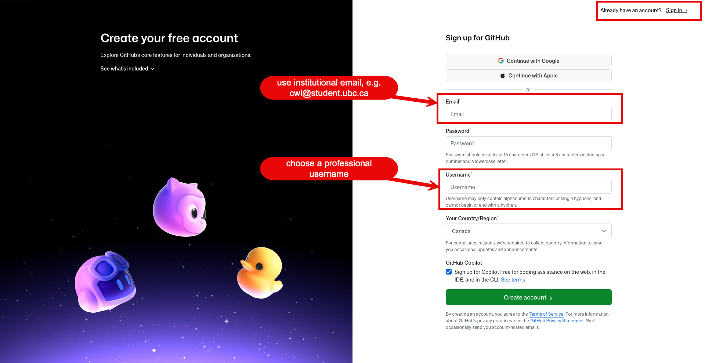

# 1. Create a GitHub account

You don't need to install anything on your own computer for this course. You work in a
**Codespace**: a computer in the cloud that opens in your browser, with R, Quarto and VS Code
already installed. To get one, you need a GitHub account.

## If you don't have an account

1. Open <https://github.com/signup>.
2. Follow GitHub's prompts to enter your email address, choose a password and choose a username.

## If you already have an account

Sign in at <https://github.com/login> and check that you can open your profile. You can use this
account for the course. You only need a second account if your current username or profile
isn't appropriate for coursework.

## Choose a professional username

Pick a username you would be comfortable putting on a resume. A simple pattern works well, such
as first-last or initials: for example, `maria-chen` or `j-smith-health`.

Use the same account and username for the whole course. Write your username down exactly as it
appears in your profile's web address (`https://github.com/<your-username>`).

## Protect your account

- Use a long, unique passphrase that you don't use on any other site.
- Consider a password manager, so you don't have to memorize it.
- Turn on two-factor authentication (2FA) when GitHub asks, and keep it on. 2FA adds a second
  login step (a code from an app or a text message), so your account stays protected even if
  someone learns your password.
- Know which email address is attached to your account.

## If you can't get into an existing account

- Try GitHub's account recovery before creating a new account.
- Use the email address most likely attached to the account.
- Check whether your browser is signed in to a different GitHub account.

Never share your password, recovery codes or tokens with anyone, including the teaching team.

For more help, see GitHub's getting-started guide: <https://docs.github.com/en/get-started>.

---

Next: [2. Sign up for GitHub Copilot](02-copilot.md)

*Adapted from [Week 0: Asynchronous Onboarding](https://ehsanx.github.io/HDSx/weeks/week00-onboarding/index.html)
in the HDSx course book.*
