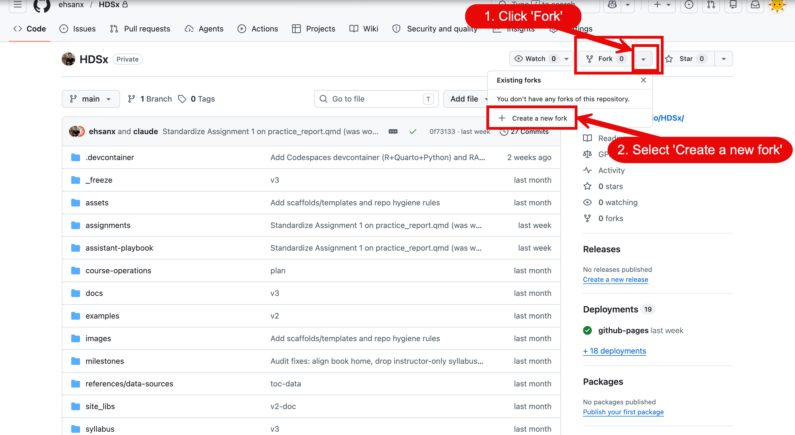
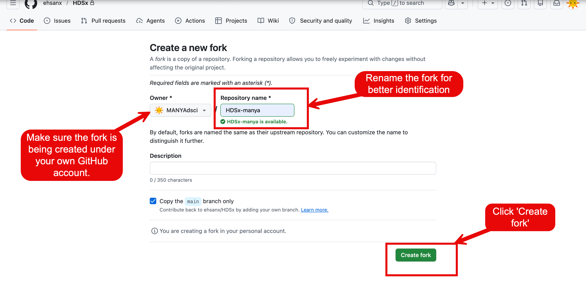
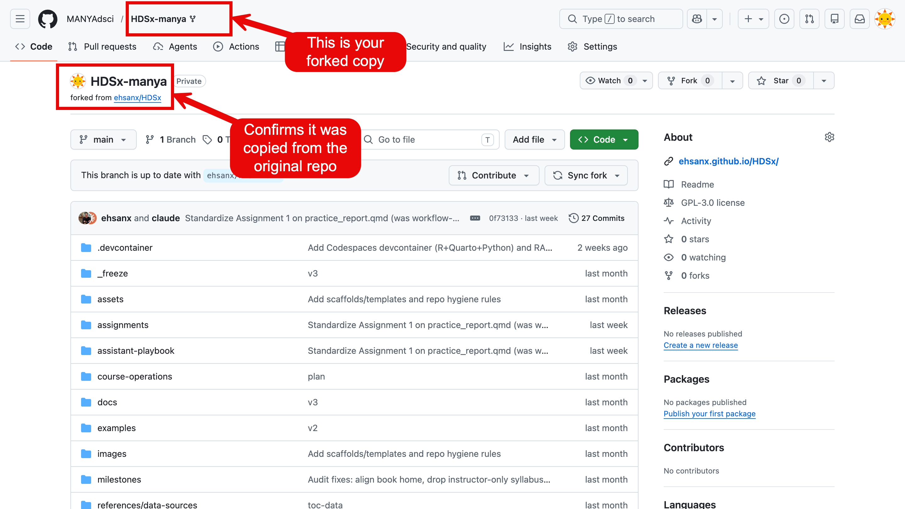
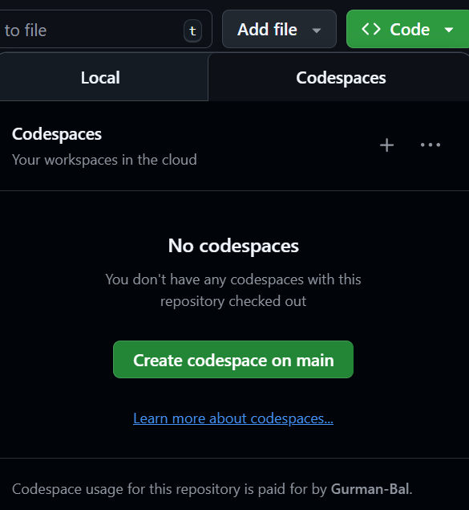
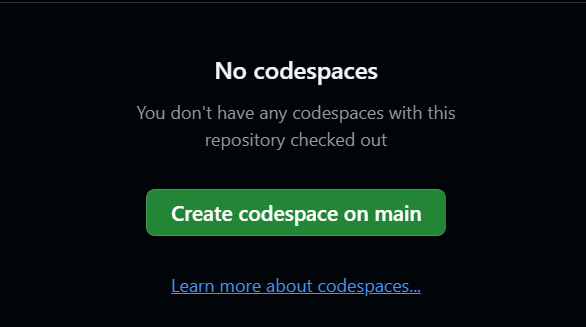
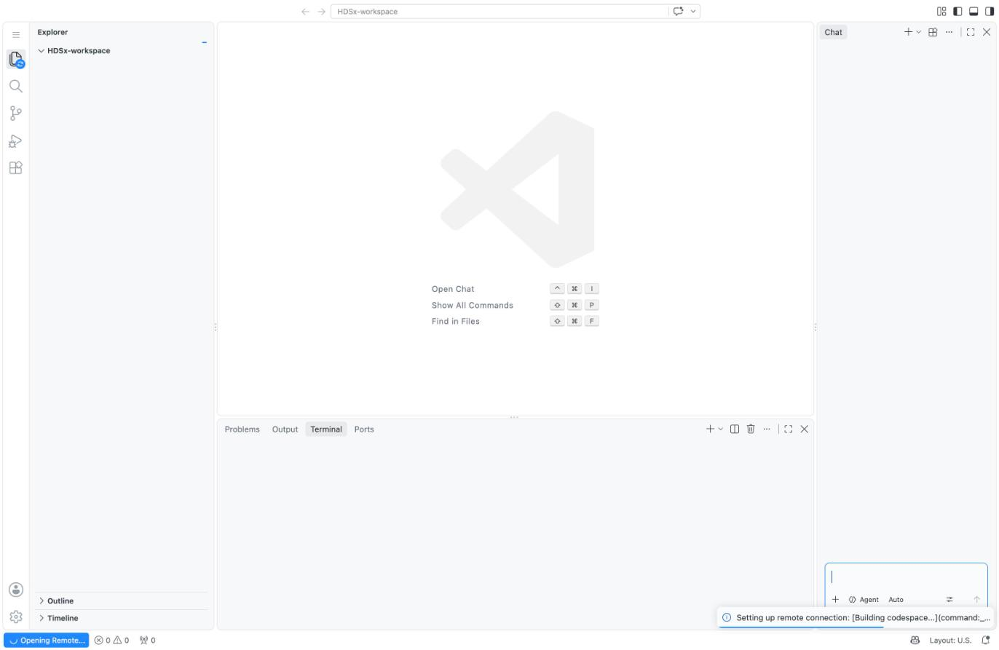
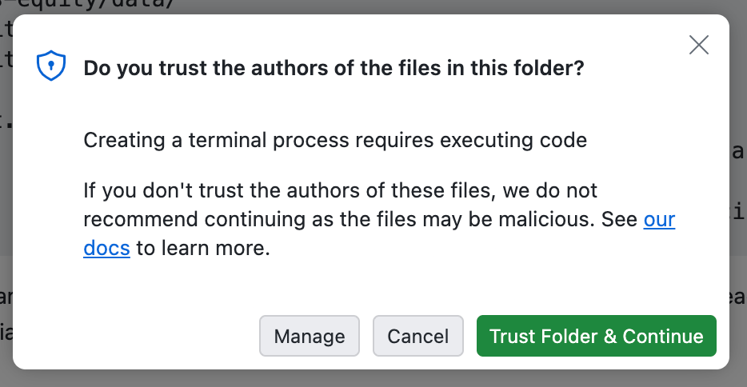
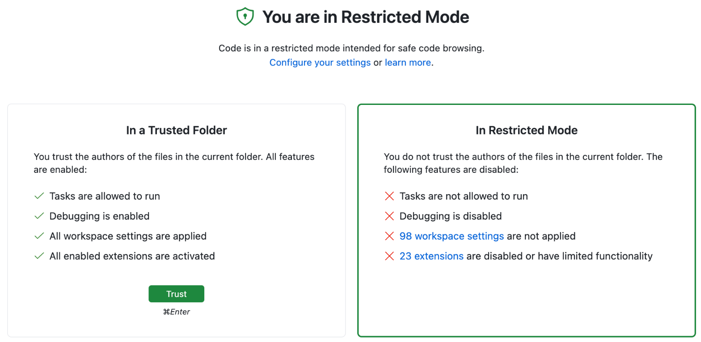

# 3. Open your Codespace

A Codespace is like walking into a library and turning on one of its computers. First you make
your own copy of this repository, then you start a computer in the cloud from it.

The screenshots come from the HDSx course, so they show that course's repository names. Your
screen shows `HMHDA-0115-2026W1` instead.

## Step 1: Make your own copy (a fork)

Your copy is called a **fork**. You work in your fork, so your changes never affect the original
course repository.

1. Open the course repository: <https://github.com/chendaniely/HMHDA-0115-2026W1>.
2. Click **Fork**, near the top right of the page.

   

3. On the **Create a new fork** page, check that **Owner** is your own GitHub account, then
   click **Create fork**.

   ⚠️ Your fork is **public**: anyone on the internet can see it. Never put real patient data
   or any other private information in it.

   

4. Check that the fork is in your account. The web address reads
   `https://github.com/<your-username>/HMHDA-0115-2026W1`, and under the repository name it says
   **forked from chendaniely/HMHDA-0115-2026W1**. If the owner is wrong, delete the fork and
   start again.

   

## Step 2: Create the Codespace

Start from **your fork**, not the original repository.

1. Click the green **Code** button. This button is usually for downloading files, but here it
   starts a computer.

   

2. Click the **Codespaces** tab. There are two tabs, **Local** and **Codespaces**. **Local**
   means downloading the files to your own laptop. **Codespaces** means using the cloud computer
   that is already set up, so always choose this one.

   

3. Click **Create codespace on main**. GitHub starts a new computer for you.

   

## Step 3: Wait about 5 minutes the first time

GitHub is downloading a computer that already has R, Quarto and all the course packages
installed. Nothing is installed while you wait. The bottom-left corner says
**Opening Remote…** until it is done.

## Step 4: Trust the folder

When VS Code appears in your browser, a box asks: **Do you trust the authors of the files in this
folder?** These are the course files, so click **Trust Folder & Continue**.

If you clicked **Cancel** or closed the box, VS Code stays in **Restricted Mode**. A grey banner
sits at the top, and the course tools stay switched off.

To fix it, click **Manage** in that banner, then click **Trust**.

## Step 5: Check that it's ready

VS Code keeps loading its tools for a few seconds after it appears. Watch the **bottom bar**:

- **Not ready yet:** a spinning message, such as **Activating Extensions…**

  

- **Ready:** the spinning message is gone, and **Quarto** shows a version number.

  

Your Codespace is ready. Next, try R with `example.R`.

## If it never gets ready

If the bottom bar still doesn't show **Quarto** after a couple of minutes:

1. Press `F1` to open the Command Palette, type `creation log`, and click
   **Codespaces: View Creation Log**.
2. Send that log to the teaching team.
3. Don't try to install software yourself. Rebuild the Codespace instead
   ([Troubleshooting](07-troubleshooting.md)), and ask for help if it still fails.

## Next time: reopen the same Codespace

Don't create a new Codespace each time. A second Codespace is a second computer, and any work
you haven't committed stays on the first one.

1. Go to <https://github.com/codespaces>.
2. Find the box labelled with this course's repository name. GitHub gives each Codespace a
   random name, such as *glorious-couscous*.
3. Click that name. Don't click **New codespace**.

Reopening is much faster than creating a new Codespace, because everything is already there.

---

Next: [4. Try R with `example.R`](04-try-r.md)

*Adapted from [Week 0: Asynchronous Onboarding](https://ehsanx.github.io/HDSx/weeks/week00-onboarding/index.html),
[Opening Your First Codespace](https://ehsanx.github.io/HDSx/weeks/week02-modern-workflows/workflows03-open-codespace.html)
and [Reopening a Codespace](https://ehsanx.github.io/HDSx/weeks/week02-modern-workflows/workflows04-reopen-codespace.html)
in the HDSx course book.*
