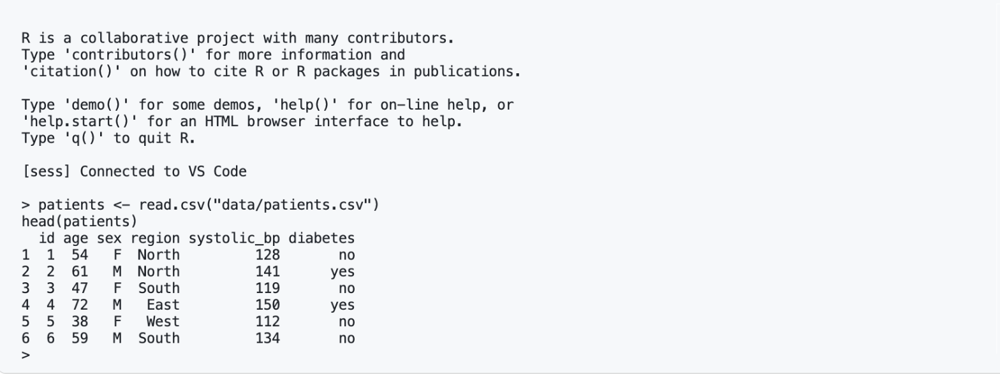
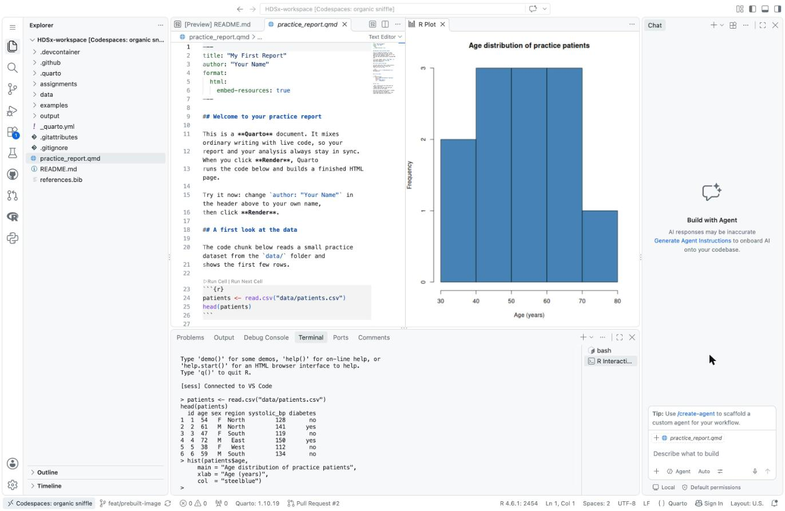

# 4. Try R with `example.R`

`example.R` is a short R script. Running it checks that R, the course packages and plots all
work in your Codespace. It reads `patients.csv`, a small practice dataset next to it.

1. In the **Explorer** on the left, click `example.R`. It opens in the editor in the middle.
2. Click anywhere on the line `patients <- read.csv("patients.csv")`.
3. Press **Ctrl+Enter** (**Cmd+Enter** on a Mac). This runs the line your cursor is on.

   The first time, R starts in the **Terminal** at the bottom. It prints
   `[sess] Connected to VS Code`, and then runs your line.

4. Click on the next line, `head(patients)`, and press **Ctrl+Enter** again. The first six rows
   of the data appear in the Terminal.

   

5. Keep going down the file the same way. When you run the `hist(...)` lines, the chart opens
   in an **R Plot** tab next to your file. The last chart, from `ggplot(...)`, opens in the same
   tab.

   

To run the whole file at once, click inside it, select everything (**Ctrl+A**, or **Cmd+A** on a
Mac), then press **Ctrl+Enter**.

The screenshots come from the HDSx course, where the same data sits in a `data/` folder. In this
repository, `patients.csv` is next to `example.R`.

If you see red text in the Terminal, that's an error message. Read it: it usually says what went
wrong. If R can't find a package, don't install it yourself. See
[Troubleshooting](07-troubleshooting.md).

---

Next: [5. Try Quarto with `example.qmd`](05-try-quarto.md)

*The screenshots are from [Render Quarto](https://ehsanx.github.io/HDSx/weeks/week02-modern-workflows/workflows07-render-quarto.html)
in the HDSx course book.*
