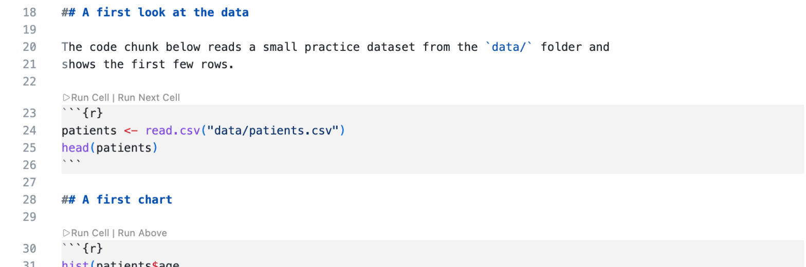
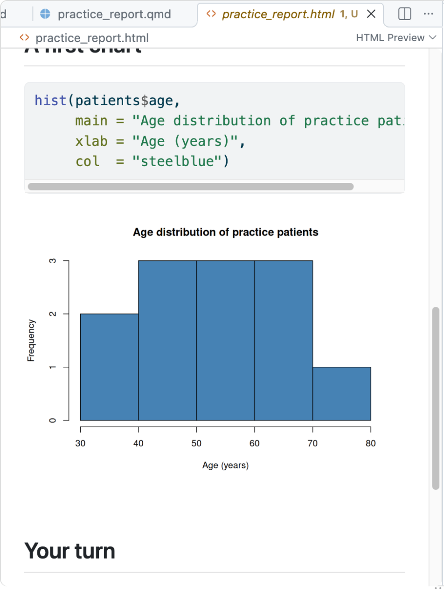
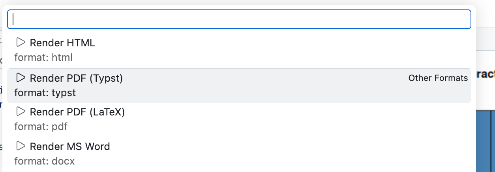
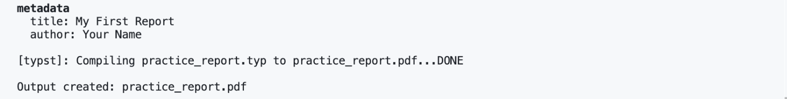

# 5. Try Quarto with `example.qmd`

Think of a `.qmd` file as a **recipe**, and the finished report (HTML or PDF) as the **meal**.
You don't change the meal: you change the recipe. **Rendering** is the cooking. Quarto follows
your recipe from scratch and makes a fresh report each time, so anyone with your `.qmd` file can
make the same report.

The screenshots come from the HDSx course, so they show its file, `practice_report.qmd`. Yours
is `example.qmd`, and it makes `example.html`.

## Step 1: Open the file

In the **Explorer** on the left, click `example.qmd`. It opens in the editor: a mix of ordinary
text and grey code chunks.

## Step 2: Put your name on it

At the very top of the file, between two lines of three dashes (`---`), is the **YAML header**.
It holds the document's title, author and format. Find this line:

```yaml
author: "Your Name"
```

Replace `Your Name` with your own name. Keep the quotes.

## Step 3: Run a code chunk

You can try one chunk at a time before rendering the whole report. A **Run Cell** link sits
above each grey R chunk.



1. Click **Run Cell** above the first chunk. The first time, R starts in the **Terminal** at the
   bottom, prints `[sess] Connected to VS Code`, and then runs your code.

   

2. Click **Run Cell** above the chart chunk. The chart opens in an **R Plot** tab next to your
   file.

   

## Step 4: Render

1. Save the file (**Ctrl+S**, or **Cmd+S** on a Mac).
2. Open the **Command Palette**: click **View → Command Palette**, or press **Ctrl+Shift+P**
   (**Cmd+Shift+P** on a Mac).
3. Type `render`, and click **Quarto: Render Document**.

   

4. When it asks which format, click **Render HTML**.

   

5. Watch the **Terminal** at the bottom. Text scrolls past as your code chunks run. When it
   prints **Output created: example.html**, your report is ready.

   

If the menu doesn't appear, you can always render from the Terminal instead. Type this and press
**Enter**:

```bash
quarto render example.qmd
```

## Step 5: Look at your report

`example.html` is saved right next to `example.qmd` in the Explorer. Click it. It opens in a tab
inside VS Code, showing your formatted report with your name on it.




The tab doesn't update by itself. After you render again, close the tab and click `example.html`
again. To open the report in your own browser instead, right-click the file and click
**Download**.

## Want a PDF? (optional)

1. Run **Quarto: Render Document** again, and click **Render PDF (Typst)**. Typst comes with
   Quarto. It's fast, and it keeps characters such as Greek letters and emoji, which the LaTeX
   option can silently drop.

   

2. Wait for **Output created: example.pdf**.

   

3. Click `example.pdf` in the Explorer. It opens in a PDF tab.

   

Everything a PDF needs is already installed, so don't install anything.

## These are not errors

- **"Problems 1" and a yellow file name** while your `.html` file is open: VS Code is checking
  the page styling that Quarto wrote. Your report is fine, and the note goes away when you close
  the tab.

  

- **Notifications under the bell** in the bottom-right corner: a suggested extension, a question
  about "git fetch", or a note asking you to support the PDF viewer's makers. You don't need any
  of them, and you never need to pay anything. Close each one with its **×**.

  

## If it fails

- **Wait:** if nothing happens for 20 seconds, Quarto may still be starting. Give it a moment.
- **Retry:** sometimes the connection hiccups. Run **Quarto: Render Document** once more.
- **Read the red text:** red text in the Terminal is an error message. It usually says what went
  wrong, for example "File not found".

Still stuck? See [Troubleshooting](07-troubleshooting.md).

---

Next: [6. Stop your Codespace](06-stop-codespace.md)

*Adapted from [Render Quarto](https://ehsanx.github.io/HDSx/weeks/week02-modern-workflows/workflows07-render-quarto.html)
in the HDSx course book.*
