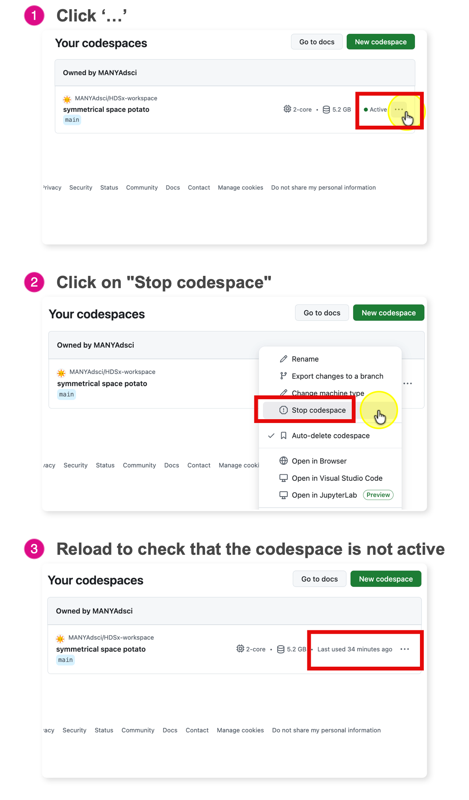

# 6. Stop your Codespace

GitHub Free personal accounts currently include 120 core-hours of Codespaces each month. On this
course's 2-core machine, that's about 60 hours of running time.

Think of a Codespace like a **taxi**:

- **Working:** while you are coding, the meter is running.
- **The trap:** closing your browser tab is like getting out of the taxi and asking the driver to
  wait. **The meter keeps running.**
- **The fix:** end the ride by stopping the Codespace.

## Stop it when you finish

1. Go to <https://github.com/codespaces>.
2. Find your Codespace. A running one is marked **Active**.
3. Click the **…** menu on the far right of its row.
4. Click **Stop codespace**.

**Stop** keeps your saved files and the installed software for next time. Anything still running,
such as data loaded in R, is cleared. Don't choose **Delete**: that throws the computer away, and
any work you haven't committed goes with it.

⚠️ Closing the browser tab is **not** enough. GitHub keeps the Codespace running until it has been
idle for 30 minutes. If you just close the tab every day, you waste about 15 hours of your
monthly allowance.

To keep within your allowance, reopen the same Codespace each time instead of creating a new one
([3. Open your Codespace](03-open-codespace.md#next-time-reopen-the-same-codespace)).

---

*Adapted from [Stop Your Codespace](https://ehsanx.github.io/HDSx/weeks/week02-modern-workflows/workflows10-stop-codespace.html)
and [Week 0: Asynchronous Onboarding](https://ehsanx.github.io/HDSx/weeks/week00-onboarding/index.html)
in the HDSx course book.*
